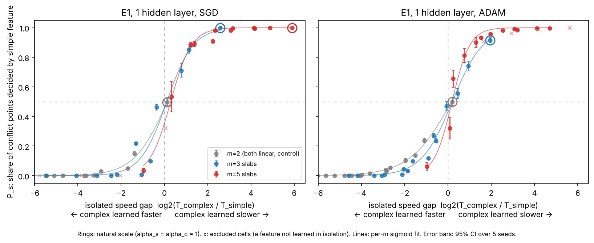
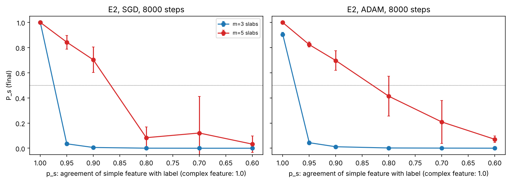
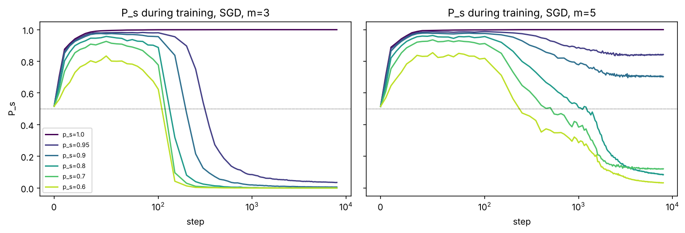
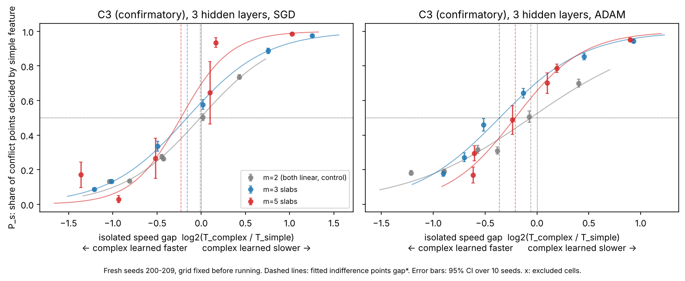
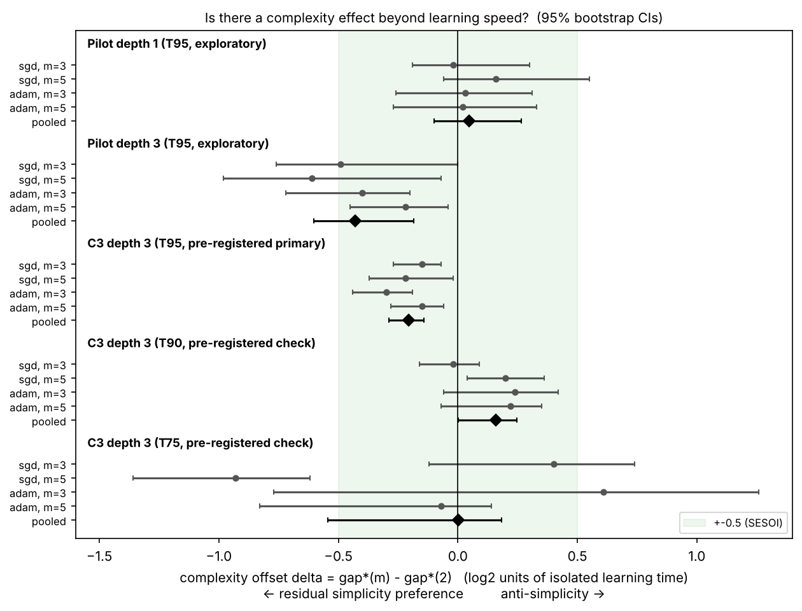

# Simple, or Just Fast? Separating Feature Complexity from Learning Speed in Simplicity Bias

*A falsification-oriented research proposal, with a small implemented pilot study.*

---

## 0. Summary

The claim under examination is: *when several features predict the label, neural networks preferentially learn the simpler one.* The best-known evidence (Shah et al., 2020) uses synthetic data where a linear coordinate and a k-slab coordinate both perfectly predict the label, and the trained network relies almost entirely on the linear one.

My skeptical reading is that in those experiments "simpler" is confounded with "learned faster by gradient descent from this initialisation, at this input scale". Function-class complexity (how many linear pieces a feature needs) does not change if you multiply a coordinate by 4. Learning speed does. So the two can be pulled apart, and that gives a sharp test:

> **If we equalise how fast each feature is learned on its own, does the network still prefer the simpler one?**

I propose an experiment suite built around this question, plus two further axes (predictive strength, and architecture/optimiser). I implemented the core of it on a laptop-scale budget: 2,310 exploratory pilot runs of a small MLP on CPU, then 1,080 pre-registered confirmatory runs for the one finding that needed it. The results are in Section 8. The short version is at the end of this summary, written after the runs finished.

**What I am not claiming.** I am not trying to show that simplicity bias "is false". Even if speed explains the preference, the claim may survive in a weaker, more precise form ("at the natural scale of the data, more complex features happen to be slower to learn, so they lose"). The point is to find out which form of the claim the evidence supports.

**Results in brief (2,310 exploratory pilot runs plus 1,080 pre-registered confirmatory runs).**
1. **The classic result reproduces.** At natural scale the network uses only the linear feature.
2. **Rescaling flips the preference.** Rescaling a coordinate leaves its complexity unchanged, yet it flips the preference in both directions.
3. **1 hidden layer: no detectable complexity effect.** Once the two features are equally fast to learn in isolation, a 3-slab or 5-slab feature is preferred about as often as a second linear feature. The pooled complexity offset is 0.05 (log2 units of learning time), 90% CI [−0.07, 0.23]. That is inside a ±0.5 equivalence bound, but the analysis is exploratory.
4. **3 hidden layers: a small offset that depends on how speed is measured.** A pre-registered rerun with fresh seeds confirmed a residual preference for the simpler feature: pooled offset −0.21, 95% CI [−0.29, −0.14]. That means the complex feature must be learned about 1.16× faster before the network is indifferent. However, the pre-registered robustness check failed. When isolated speed is measured as time to 90% rather than 95% training accuracy, the offset becomes +0.16 [0.00, 0.25]. So the sign of any effect beyond speed depends on how "speed" is defined.
5. **Imperfect shortcuts lose.** Making the simple feature wrong on 5% of examples makes the network switch to a fully predictive 3-slab feature after longer training. The exclusive "extreme" form of the bias therefore depends on both features being perfect.

**My conclusion:** I attempted to falsify the claim and could not falsify the *observation*. In this setting, isolated learning speed predicts which feature wins. Any effect of complexity beyond speed is small, and in this study it cannot be told apart from the choice of speed metric.

---

## 1. Introduction

The simplicity-bias claim matters because it is used to explain two opposite things. It is offered as a reason deep networks generalise (they find simple functions among many that fit), and as a reason they fail out of distribution (they latch onto a simple shortcut such as a background colour and ignore the robust but more complex shape). If the claim is right, the cure for shortcut learning is to change what the network finds "simple". If the observed preference actually comes from something else, such as which feature has the largest gradient signal at initialisation, then the cure is different: rescale, reweight or re-optimise, not re-architect.

The claim is also vague in a way that makes it hard to falsify. "Simple" can mean linearly separable, low-frequency, few parameters, short description length, low-dimensional, or "easy to optimise". The last definition makes the claim close to circular: if "simple" means "what SGD learns first", then "SGD learns simple features first" cannot fail. A useful version of the claim must use a definition of simplicity that is fixed *before* training and is independent of the optimiser. This proposal uses such a definition (number of linear pieces in a one-dimensional feature) and then asks whether it carries any explanatory weight once optimiser-dependent learning speed is controlled.

## 2. Literature review

**Shah et al. (2020), "The Pitfalls of Simplicity Bias in Neural Networks" (NeurIPS).** Introduces the LMS-k datasets: one coordinate is linearly separable, the others are k-slab (the label alternates across k intervals), and all are fully predictive. MLPs, CNNs and other models trained with standard SGD rely almost exclusively on the linear coordinate (randomising it drops accuracy to chance; randomising the slab coordinates does nothing). They call this *extreme* simplicity bias and connect it to poor robustness. Their operational definition of simplicity is the number of linear pieces needed to separate the classes along a coordinate. They also show a MNIST-CIFAR "dominoes" version on real images. The authors note that the definition of simplicity is itself an open issue.

*What it assumes:* the features are presented at a fixed, roughly comparable scale (all in [-1, 1]) with fixed margins, and training stops once the training loss is small. Neither scale nor margin is varied, so "fewer linear pieces" and "larger gradient signal per example at initialisation" move together.

**Morwani et al. (2023), "Simplicity Bias in 1-Hidden Layer Neural Networks" (NeurIPS).** Gives a formal definition: a network is simplicity-biased if it depends only on the lowest-dimensional projection of the input that suffices for good training performance. In an infinite-width, small-initialisation (mean-field-like) regime for one-hidden-layer networks, they prove the trained network depends on a low-dimensional projection, and they use this to motivate a method that trains a second model on the complementary subspace to get more diverse features.

*What it assumes:* a specific training regime (one hidden layer, a particular scaling limit). Their simplicity is "dimension of the relevant projection", which is a different notion from Shah et al.'s "number of pieces"; in my setup both features are one-dimensional, so their definition does not distinguish them, which is itself informative.

**Rahaman et al. (2019), "On the Spectral Bias of Neural Networks" (ICML).** ReLU networks learn low-frequency components of a target function faster than high-frequency ones, and the effect depends on the geometry of the data manifold. A k-slab feature with larger k is a higher-frequency square wave along its axis, so spectral bias predicts it is learned more slowly. This is already a *speed* statement, not a statement about the final solution. It suggests that "simplicity bias" in the final solution may be downstream of spectral bias in the dynamics, plus the fact that training stops once the loss is small.

**Related work I am aware of and would check in detail before submission** (cited from memory; details should be verified):
- Hermann & Lampinen (2020), *What shapes feature representations? Exploring datasets, architectures, and training* (NeurIPS): when two features are equally predictive, models prefer the one that is easier to extract (for example linearly decodable), and the easier feature can suppress the other.
- Hermann, Mobahi, Fel & Mozer (2024), *On the Foundations of Shortcut Learning* (ICLR): distinguishes a feature's *predictivity* from its *availability* (how easily it can be extracted, controlled for example by amplitude or by nonlinearity) and finds models can prefer a more available but less predictive feature. This is the closest prior work to this proposal. My design differs in that it calibrates availability by *measured isolated learning speed* and then asks whether complexity has any residual effect once that speed is matched.
- Pezeshki et al. (2021), *Gradient Starvation* (NeurIPS): once some features drive the cross-entropy loss down, gradients for other features shrink, so a feature learned first can block others. This is a mechanism by which a speed difference turns into an *exclusive* preference.
- Kalimeris et al. (2019), *SGD on Neural Networks Learns Functions of Increasing Complexity*: networks first learn functions explainable by a linear model, then more complex ones.
- Valle-Pérez, Camargo & Louis (2019), *Deep learning generalizes because the parameter-function map is biased towards simple functions*: a simplicity bias argument at the level of the prior over functions, independent of optimisation.
- Geirhos et al. (2020), *Shortcut Learning in Deep Neural Networks*: review of the phenomenon on real data.

**Open questions this proposal targets.**
1. Is "simple" doing causal work, or is it a proxy for "has a larger effective learning rate under this parameterisation"?
2. When the simpler feature is less predictive, does the network still prefer it, and does longer training change that?
3. Does the answer depend on the optimiser (SGD vs Adam) or depth? An intrinsic property of the feature should not.

## 3. Research question

**Main question (RQ1).** In a two-feature binary classification task where both features are fully predictive, and where feature complexity (number of linear pieces) and isolated learning speed are varied independently, does complexity predict which feature a small MLP relies on *after controlling for* isolated learning speed?

**Secondary questions.**
- **RQ2 (predictive strength).** If the simple feature is made less predictive than the complex one, at what point does the network switch to the complex feature, and does the switch depend on training duration?
- **RQ3 (optimiser and architecture).** Do the answers to RQ1 and RQ2 change between SGD with momentum and Adam, or between 1 and 3 hidden layers?

## 4. Definitions and measurements (fixed before training)

**Complexity of a feature.** A one-dimensional coordinate in [-1, 1] split into *m* equal slabs with alternating class labels. The class boundary along that coordinate has *m - 1* breakpoints. *m = 2* is a plain linear threshold (the "simple" feature); *m = 3* and *m = 5* are the "complex" features. This is Shah et al.'s definition. Adjacent slabs are separated by a fixed gap of 0.1, so the *minimum* margin is the same for every *m*.

**Learning speed of a feature (in isolation).** Train the same network, with the same optimiser and step budget, on a dataset where *only* that feature carries label information. The other feature is still present with its usual marginal distribution but is drawn from an independent random label. *T* = number of optimiser steps until training accuracy first reaches 95%. I use the median over seeds. The **speed gap** is

  gap = log2( T_complex / T_simple ),

so gap > 0 means the complex feature is slower to learn on its own.

**Reliance (the outcome).** Two measures, both on held-out data:
1. *Conflict preference* **P_s**: build test points where the simple feature is drawn from class A and the complex feature from class B (each from its training marginal, only the pairing is new). P_s is the fraction classified as A. P_s = 1 means the decision follows the simple feature; 0 means the complex one; 0.5 means a balanced mixture.
2. *Randomisation drop*: test accuracy minus accuracy after shuffling one coordinate across test points (Shah et al.'s test). Used as a cross-check.

**Indifference point gap\*.** For each complexity level, fit logit(P_s) as a linear function of gap across conditions and solve for the gap where P_s = 0.5. If speed alone explains the preference, gap\* = 0 for every *m*. If complexity has an effect beyond speed, gap\* < 0 for *m* > 2 (the complex feature must be learned *faster* than the simple one before it wins).

## 5. Hypotheses

Let *P_s(m, gap)* be the conflict preference for the simple feature.

- **H_SB (the literature's hypothesis, intrinsic form).** Complexity itself drives the preference: at matched isolated speed (gap = 0), networks still prefer the simpler feature, i.e. gap\*(m) < 0 for m = 3, 5, with the effect growing in m. A strong version: P_s stays above 0.5 across *all* achievable scale settings.
- **H_speed (my working hypothesis).** The preference is explained by isolated learning speed. P_s is a single decreasing function of the speed gap, the same for every m, crossing 0.5 near gap = 0. Complexity matters only because, at the default input scale, more slabs make a feature slower to learn.
- **H0 (null for the complexity effect).** After matching isolated learning speed, complexity has no effect on preference: gap\*(m) = gap\*(2) (≈ 0 by symmetry) for m = 3, 5. Rejected in favour of H_SB if the 95% CI of gap\*(m) lies entirely below gap\*(2); rejected in the anti-simplicity direction if it lies entirely above.

H_speed and H0 make the same prediction about gap\*; H_speed additionally predicts that the logistic curves for different m have similar slopes, so that speed gap is a sufficient statistic. Note that "failing to reject H0" here is the outcome that would *qualify* the simplicity-bias claim.

**Alternative explanations the design must separate.**
1. **Ease of optimisation / gradient magnitude.** A feature with larger input scale or a larger margin produces larger gradients on first-layer weights, so it is fitted first. Under SGD, scaling a coordinate by α scales the effective learning rate of its first-layer weights by roughly α²; under Adam it is different, but still not invariant. This is the main competitor and is manipulated directly.
2. **Predictive strength.** In the original setup both features are 100% predictive, so predictive strength cannot explain a preference there; but in real data the shortcut is often *more* correlated with the label on the training set. Manipulated in E2.
3. **Loss saturation / gradient starvation.** Once one feature drives the training loss near zero, there is little gradient left to learn the other. This converts a small speed difference into exclusive reliance. It predicts that making the first-learned feature imperfect (E2) or training longer should increase reliance on the second feature.
4. **Architecture.** ReLU MLPs build piecewise-linear functions, so "number of pieces" is architecture-relative. A network with periodic activations could find a slab pattern cheap. (Proposed, E4; not run.)
5. **Data geometry confounds introduced by the complexity knob itself.** In [-1, 1], more slabs means narrower slabs, so the *average* distance to a class boundary shrinks with m. Margin and complexity are coupled by construction. The speed calibration absorbs this, but it means the study measures "complexity including its natural margin cost".

## 6. Proposed experiment suite

### 6.1 Data (shared by all experiments)

Inputs x ∈ R^22:
- x₁ = α_s · f_s, the simple feature (m = 2 slabs).
- x₂ = α_c · f_c, the complex feature (m ∈ {2, 3, 5} slabs; m = 2 makes it statistically identical to x₁ and serves as the symmetry control).
- x₃…x₂₂ ~ U[-1, 1], 20 label-independent noise coordinates (as in Shah et al., noise dimensions make memorisation possible, so a network can reach 100% training accuracy without using a feature properly).

Labels y ∈ {−1, +1}, balanced. Each feature is drawn from the slabs of class y with probability p (its *predictive strength*) and from the slabs of −y otherwise, so changing p never changes the feature's marginal distribution. Defaults: p_s = p_c = 1. Training set n = 4,000; clean test set n = 4,000; conflict test set n = 4,000. Every run draws fresh data from its seed.

### 6.2 Fixed across experiments
Training set size, noise dimensions, slab gap, loss (cross-entropy), batch size 128, PyTorch default initialisation, width 128, ReLU, 4,000 steps (8,000 in E2), no weight decay, no augmentation, no early stopping. Per optimiser, one learning rate chosen in the pilot so that every condition trains stably (SGD + momentum 0.9 at 0.05; Adam at 1e-3). No hyperparameter search per condition, since tuning per condition would itself change learning speed.

### 6.3 Experiments

| ID | Question | What varies | What is held fixed | Status |
|---|---|---|---|---|
| **E1** Speed–complexity decoupling | RQ1 | m ∈ {2, 3, 5}; α_s ∈ {1, 0.3, 0.1, 0.03}; α_c ∈ {1, 2, 4, 8}; optimiser ∈ {SGD, Adam}. For each cell: one *joint* run and two *isolated* runs (only_s, only_c). | Depth 1, p = 1 | Run, 5 seeds |
| **E2** Predictive strength | RQ2 | p_s ∈ {1, .95, .9, .8, .7, .6} with p_c = 1; m ∈ {3, 5}; optimiser | Natural scale α = 1, depth 1, 8,000 steps, P_s tracked over training | Run, 5 seeds |
| **E3** Depth | RQ3 | Depth 3 at a subset of E1 cells (α pairs (1,1), (1,4), (1,8), (0.1,8)); extended after a first look with 4 more cells and the m = 2 control (Section 8.1) | Everything else as E1 | Run, 5 seeds |
| **R1** Noise robustness | Is the scale effect an artefact of signal-to-noise against the 20 noise dims? | Same as E1 subset but with no noise coordinates | SGD, depth 1 | Run, 5 seeds |
| **E4** Architecture with different priors | Is "complexity" architecture-relative? | Replace ReLU with sin activations (or add a fixed Fourier featurisation of each coordinate) so that a slab pattern becomes low-complexity for the model. Repeat E1. Prediction under H_speed: the gap–preference curve is unchanged, only the gaps move. | E1 grid | Proposed |
| **E5** Competing definitions of simplicity | Do two definitions disagree? | Pair a 2-bit parity (tiny description length, zero linear correlation with any single coordinate, slow for gradient descent) against a 5-slab feature (longer description, but has local linear structure). Measure which wins. Also pair "low frequency but high-dimensional" (a linear direction spread over many coordinates) with a one-coordinate 3-slab. | E1 protocol | Proposed |
| **E6** Order and hysteresis | Is the preference path-dependent? | Pre-train on only_c for K steps, then switch to joint data. If the network keeps the complex feature, the "bias" is about what was learned first, not about the final optimum. | Natural scale | Proposed |
| **E7** Real-data check | Does the decoupling transfer? | MNIST-CIFAR dominoes; scale the contrast of the MNIST half vs the CIFAR half to move isolated learning speeds, and repeat the indifference analysis with a small CNN. | — | Proposed |

**Why rescaling is a fair manipulation of speed but not of simplicity.** Multiplying a coordinate by a constant changes neither the number of linear pieces, nor the Bayes classifier, nor the description length of the rule, nor its linear separability. A network with a scale-invariant input normalisation would be unaffected. It does change the gradient signal under standard initialisation. So if rescaling alone flips the preference, the preference cannot be a property of the feature's complexity alone. Rescaling is not a perfect speed knob: it also changes margin relative to the noise coordinates (checked in R1) and it saturates, which is why E1 also slows the simple feature down (α_s < 1) rather than only speeding the complex one up.

### 6.4 Evaluation and statistics
- Unit of analysis: seed (data draw + initialisation). 5 seeds per cell in the pilot; the full study would use 20 to give tighter intervals on gap\*.
- Per cell: mean P_s with a t-based 95% CI; randomisation drops; clean test accuracy; isolated test accuracy (to confirm the isolated runs actually learned the feature rather than memorising).
- Primary test: the **complexity offset** δ(m) = gap\*(m) − gap\*(2), with a 95% bootstrap CI and p-value. The bootstrap resamples seeds within cells, for both the joint and the isolated runs, separately per optimiser and depth.
  - Holm correction is applied across the four (optimiser × m) tests in each depth.
  - The **pooled offset** (mean over both optimisers and m = 3, 5) is the single primary estimate per depth.
  - H0 is rejected in favour of H_SB if the 95% CI of δ lies entirely below 0.
  - An offset is called negligible if its 90% CI lies within ±0.5 (the smallest effect size of interest, a 1.41× speed ratio).
  - *Revision after review:* the pilot originally used "the CI for gap\*(m) lies entirely below the CI for gap\*(2)". That rule is too conservative and tests the wrong quantity, so it was replaced. The replacement was chosen after the pilot data were seen, which is why the depth-3 claim was re-tested in a pre-registered run (Section 8.8 and `preregistration.md`).
- Sample size: the pilot's 5 seeds per cell gave a minimum detectable pooled depth-3 offset of about 0.30 at 80% power (`results/stats_pilot.md`). The confirmatory run uses 10 seeds and a denser, pre-fixed grid, for a projected minimum detectable offset of about 0.21.
- Cells where an isolated run never reaches 95% within budget are *censored* and excluded from the fit (reported in the tables). After the pilot I added a second exclusion: cells where an isolated run reaches 95% training accuracy but under 95% test accuracy, i.e. it memorised rather than learned the feature (Section 8.1).
- Fitting: P_s = sigmoid(b · (gap − gap\*)) by least squares on seed-level values (robust to cells where P_s is exactly 0 or 1).
- Secondary: E2 indifference p_s (where P_s crosses 0.5) and whether it moves between step 500 and step 8,000.

## 7. Controls and baselines

| Control | What it rules out |
|---|---|
| **Symmetry control (m = 2 vs m = 2).** Both features linear and identically distributed. At α_s = α_c, P_s must be ≈ 0.5. | A bug, or an asymmetry in coordinate order, initialisation or the conflict test. |
| **Scale sweep on the symmetry control.** Scaling one of two identical linear features. | Establishes how strongly pure scale moves preference when complexity is held *equal*; this is the speed–preference curve with no complexity difference. |
| **Isolated single-feature runs per cell.** | Gives the speed covariate, and confirms each feature is learnable on its own by this network (if the complex feature cannot be learned alone, its absence in the joint run says nothing about bias). |
| **Equal predictive strength (p = 1) in E1.** | Predictive strength cannot explain any E1 preference. |
| **Predictive strength sweep (E2).** | Measures how much extra correlation the complex feature needs to win, a "price" of complexity in units of label agreement. |
| **Two optimisers, two depths.** | An intrinsic feature property should not flip with the optimiser. If it does, optimisation is part of the explanation. |
| **No-noise variant (R1).** | Rescaling might act through signal-to-noise against the noise coordinates rather than through gradient scale. |
| **Two outcome measures (conflict test and randomisation).** | Conflict points are new combinations of in-range values; the randomisation test checks the conclusion does not hinge on that construction. |
| **No per-condition tuning, fixed step budget.** | Prevents the experimenter from changing speed through hyperparameters. |

## 8. Implemented pilot: methodology, results, analysis

### 8.1 What was run

All of E1, E2, E3 and R1 as specified in Section 6, 5 seeds per cell, plus two additions made **after** looking at the first E3 results (flagged so they are not mistaken for pre-planned tests):
- **E3b**: four extra depth-3 cells per (optimiser, m) — (α_s, α_c) ∈ {(0.3, 8), (0.5, 8), (0.3, 4), (1, 16)} — because the first E3 grid had no points near P_s = 0.5 for m = 5 and the crossover could not be located.
- **E3c**: the m = 2 symmetry control at depth 3, without which a depth-3 shift could not be told apart from a measurement offset.

In total 2,310 training runs, about 1.5 hours on 4 CPU cores. Full tables are in `results/summary.md`; the raw records are in `results/runs.jsonl`. After a structured self-review (`review/self_review.md`), the pilot was re-analysed with the offset test of Section 6.4 (`results/stats_pilot.md`). A pre-registered confirmatory run (**C3**: 1,080 runs, depth 3, fresh seeds 200 to 209) was then added. Its records are in `results/runs_confirm.jsonl` and its analysis in `results/stats_confirm*.md`.

One analysis rule was also fixed only after the pilot: a cell enters the indifference fit only if **both** isolated runs reached 95% training accuracy within budget **and** reached ≥ 95% test accuracy. Without this rule, cells with a very small α_s count a feature as "learned" when the network has really memorised the training set through the noise coordinates (isolated test accuracy around 0.7 to 0.9). Excluded cells are marked in the tables and plotted as crosses in Figure 1. They all sit at the extreme ends of the gap axis and do not change the qualitative picture.

### 8.2 Sanity checks
- **The original finding reproduces.** At natural scale (α_s = α_c = 1), depth 1, SGD: P_s = 1.000 for m = 3 and m = 5 (5/5 seeds each). Shuffling the simple coordinate drops test accuracy by 0.50 (to chance); shuffling the complex one drops it by 0.00. This is Shah et al.'s "extreme simplicity bias". With Adam the m = 3 case is slightly less extreme (P_s = 0.92).
- **Symmetry control passes.** With two identical linear features, P_s = 0.498 (SGD) and 0.500 (Adam), and both shuffle drops are ≈ 0.25.
- **The two reliance measures agree.** Across all 480 E1 joint runs, P_s and the difference in shuffle drops (drop_simple − drop_complex) are correlated at r > 0.99, so the conclusions do not depend on the off-distribution conflict construction.
- **Each complex feature is learnable alone.** In the isolated runs at natural scale, the 3-slab and 5-slab features reach ≥ 0.99 test accuracy with SGD (5-slab with Adam only reaches 0.84 in 4,000 steps; those cells are excluded by the rule above).

### 8.3 E1: once learning speed is matched, complexity adds nothing detectable (1 hidden layer)

*Figure 1. Each point is one (m, α_s, α_c) cell: x = isolated speed gap, y = mean P_s over 5 seeds. Grey: two linear features (control). Blue: 3-slab. Red: 5-slab. Rings mark the natural scale used in the literature.*

Indifference points (gap where P_s = 0.5; 95% bootstrap CI resampling seeds of both the joint and the isolated runs):

| Optimiser | m = 2 (control) | m = 3 | m = 5 |
|---|---|---|---|
| SGD | 0.13 [−0.13, 0.30] | 0.11 [0.05, 0.20] | 0.29 [0.14, 0.51] |
| Adam | 0.17 [−0.10, 0.44] | 0.20 [0.11, 0.29] | 0.19 [0.11, 0.34] |

Complexity offsets δ(m) = gap\*(m) − gap\*(2) (2,000 bootstrap resamples; `results/stats_pilot.md`):

| Optimiser | m = 3 | m = 5 |
|---|---|---|
| SGD | −0.02 [−0.19, 0.30] | 0.16 [−0.06, 0.55] |
| Adam | 0.03 [−0.26, 0.31] | 0.02 [−0.27, 0.33] |
| **Pooled** | **0.05 [−0.10, 0.27]**, 90% CI [−0.07, 0.23] | |

What this shows:
1. **Rescaling alone flips the preference.** For m = 3 with SGD, going from α_c = 1 to α_c = 8 moves P_s from 1.00 to 0.22; slowing the simple feature (α_s = 0.3, α_c = 2) gives P_s = 0.10. For m = 5, P_s goes from 1.00 at natural scale to 0.03 at (α_s = 0.1, α_c = 8). Since scale does not change the number of linear pieces, the preference at natural scale is **not** fixed by complexity alone.
2. **Speed gap predicts where the preference flips, but not how sharply.** The 2-, 3- and 5-slab curves cross 0.5 at nearly the same speed gap:
   - No offset differs from 0, before or after Holm correction.
   - The pooled offset's 90% CI, [−0.07, 0.23], lies inside the ±0.5 equivalence bound, so at depth 1 any complexity effect beyond speed is smaller than a 1.41× speed ratio.
   - This is exploratory, because the offset test and the bound were defined after the data were seen.

   The curves are *not* identical, though. The fitted slopes are steeper for the complex features: b(5)/b(2) = 1.60 [1.26, 2.18] with SGD and 2.36 [1.87, 12.18] with Adam. So H_speed's stronger prediction, that the speed gap is a sufficient statistic, fails. Speed predicts the crossover, but complex features flip from "ignored" to "used" over a narrower range of speed gaps.
3. **At natural scale the complex features lose because they are slow.** In isolation the 3-slab feature takes about 6× longer than the linear one to reach 95% (SGD: 125 vs 21 steps) and the 5-slab feature about 60× longer (1,250 vs 21). That gap, not complexity as such, is what places the natural-scale points at P_s ≈ 1.
4. **The fit is not perfect.** Some cells at similar gaps differ by 0.2 to 0.3 in P_s (for example SGD m = 3 at gap −1.32 gives 0.22, while the m = 2 control at gap −1.39 gives 0.15 and at −1.69 gives 0.05). Speed explains most of the variance, not all of it.

### 8.4 R1: the scale effect is not about noise coordinates
Without the 20 noise dimensions, the same pattern holds: gap\* = 0.17 [0.00, 0.61] for m = 3 and 0.18 [−0.29, 1.07] for m = 5. For m = 3 at (α_s, α_c) = (1, 4) the isolated speeds are identical (6 vs 6 steps) and P_s = 0.46. So rescaling does not work merely by changing signal-to-noise against irrelevant coordinates.

### 8.5 E3: with 3 hidden layers, a small residual simplicity preference appears

| Optimiser | m = 2 (control) | m = 3 | m = 5 |
|---|---|---|---|
| SGD | 0.13 [−0.22, 0.30] | −0.36 [−0.65, −0.00] | −0.48 [−0.82, −0.21] |
| Adam | 0.05 [−0.10, 0.27] | −0.35 [−0.66, −0.24] | −0.17 [−0.27, −0.05] |

All four complex-feature estimates at depth 3 are below the control. The complex feature must be learned roughly 1.1 to 1.4 times *faster* than the simple one in isolation before the deeper network becomes indifferent. For example, at Adam, m = 5, (α_s, α_c) = (0.3, 4), the complex feature is slightly *slower* alone (gap 0.11), yet P_s = 0.85.

The original CI-overlap rule rejected H0 in only one of the four cases. Testing the offset directly gives stronger results (`results/stats_pilot.md`):

| Optimiser | m = 3 | m = 5 |
|---|---|---|
| SGD | −0.49 [−0.76, 0.00], p_holm = .057 | −0.61 [−0.98, −0.07], p_holm = .035 |
| Adam | −0.40 [−0.72, −0.20], p_holm = .002 | −0.22 [−0.45, −0.04], p_holm = .045 |
| **Pooled** | **−0.43 [−0.60, −0.19]** | |

This is still **exploratory**, for three reasons:
- It rests on 8 cells and 5 seeds per (optimiser, m).
- Half of those cells were chosen after seeing data, to bracket the crossover.
- The m = 2 control has only 3 valid cells.

Section 8.8 reports the pre-registered test of it. Scale still flips the preference at depth 3: SGD m = 5 goes from 1.00 at natural scale to 0.03 at (0.3, 8).

### 8.6 E2: a little label disagreement overturns the preference, given time

*Figure 2: final P_s after 8,000 steps as the simple feature's label agreement p_s drops (complex feature stays at 1.0). Figure 3: P_s over training for SGD.*

- **3-slab:** making the simple feature wrong on 5% of training examples is enough. Final P_s drops from 1.00 to 0.035 (SGD) and from 0.90 to 0.044 (Adam), and shuffling the complex coordinate now costs 0.48 accuracy. The network ends up relying on the complex feature almost exclusively.
- **5-slab:** the switch needs much more disagreement: P_s crosses 0.5 between p_s = 0.9 and 0.8 (SGD and Adam). At p_s = 0.95 and 0.9 the network fits the conflicting training points while still mostly using the simple feature (P_s = 0.84 and 0.70; clean test accuracy falls to 0.91 to 0.96). In other words it **fits the exceptions without switching features**: train accuracy is 0.99 to 1.00 while clean test accuracy drops. This is most likely through the noise coordinates, though that was not measured directly. It happens even though the 5-slab rule is 100% predictive and learnable alone.
- **Learning order is not final reliance.** In every SGD run of E2 the network first latches onto the simple feature (P_s rises to roughly 0.85 to 0.98 within the first ~30 steps) and only later switches (Figure 3; with Adam, P_s at step 500 is still 0.42 to 0.97 for p_s ≥ 0.9, compared with its final values in the table). "Learned first" and "relied on at the end" are different claims, and the original setup (both features perfect, training stops when loss is ~0) cannot tell them apart, because once the simple feature fits everything there is no gradient left to drive the switch. This is consistent with a gradient-starvation account of the *exclusivity* in "extreme" simplicity bias.

### 8.7 Which row of the outcome table (Section 9) did the pilot land in?
- **Depth 1 (SGD and Adam):** "P_s depends on gap only; gap\* ≈ 0", but only for the crossover point. H0 was not rejected, and the offset is bounded within ±0.5 (exploratory). The speed gap predicts *where* the preference flips. Steeper slopes for complex features show it does not capture everything.
- **Depth 3:** with T95 as the speed metric, "curves shifted (gap\* < 0) but scale can still flip the preference" was confirmed in the pre-registered run. With T90 or T75 it was not (Section 8.8). The honest row is "Speed cannot be cleanly separated from complexity at this resolution". The offset exists only relative to a particular definition of speed.
- **Optimiser:** no qualitative difference between SGD and Adam in the gap–preference relation, though Adam changes the raw speeds, and with them how extreme the natural-scale preference is (m = 3: P_s = 0.92 with Adam vs 1.00 with SGD).
- **E2:** "switch to the complex feature once p_s < 1, more so with longer training" for m = 3; a much larger "price" for m = 5, where memorising exceptions competes with learning the feature.

### 8.8 Pre-registered confirmatory run (C3): the depth-3 offset replicates, but only for one speed metric

*Figure 4. C3: depth 3, fresh seeds 200 to 209, a grid fixed before running (6 cells per m, including 6 control cells). Dashed lines mark the fitted indifference points.*

`preregistration.md` fixed the following before any C3 run:
- the grid, the seeds and the primary estimand (the pooled offset at depth 3, with T95 as the speed metric);
- the decision rule;
- three secondary checks: Holm-corrected per-cell offsets, slope ratios, and T90/T75 speed metrics.

No deviations were needed. All 36 cells passed the validity rule, so dropping it changes nothing. Results (`results/stats_confirm.md`, `stats_confirm_t90.md`, `stats_confirm_t75.md`):

| Analysis | SGD m = 3 | SGD m = 5 | Adam m = 3 | Adam m = 5 | **Pooled** |
|---|---|---|---|---|---|
| T95 (primary) | −0.15 [−0.27, −0.07] | −0.22 [−0.37, −0.02] | −0.30 [−0.44, −0.19] | −0.15 [−0.28, −0.06] | **−0.21 [−0.29, −0.14]** |
| T90 (check) | −0.02 [−0.16, 0.09] | +0.20 [0.04, 0.36] | +0.24 [−0.06, 0.42] | +0.22 [−0.07, 0.35] | **+0.16 [0.00, 0.25]** |
| T75 (check) | +0.40 [−0.12, 0.74] | −0.93 [−1.36, −0.62] | +0.61 [−0.77, 1.26] | −0.07 [−0.83, 0.14] | **0.00 [−0.55, 0.18]** |

*Figure 5. Every complexity offset in this study with its 95% CI. The green band is the ±0.5 smallest effect size of interest.*

1. **The primary test replicates.** With T95, the pooled offset is −0.21 with a 95% CI entirely below 0, and all four per-cell offsets survive Holm correction (p_holm ≤ .036). By the pre-registered rule, H_SB3 is supported. The effect is **small**: its 90% CI lies within ±0.5. It is also about half the pilot estimate (−0.43), which fits the pilot's post-hoc cell selection having inflated it (R_select, partly supported).
2. **The pre-registered robustness check fails.** With T90, the pooled offset is +0.16 [0.00, 0.25], borderline in the *anti*-simplicity direction. With T75 it is 0.00 with a wide CI; T75 is reached in a median of about 16 steps, so log-ratios of such small counts are noisy. R_metric is supported. Whether the deeper network shows a residual preference for the simpler feature depends on which point of the learning curve counts as "learned".
3. **Interpretation.** The isolated learning curves have different shapes:
   - **Linear features have a long tail.** Going from 90% to 95% training accuracy takes them 1.2 to 1.6 times as long as reaching 90% (median log2(T95/T90) = 0.29 to 0.69).
   - **Slab features get there almost at once.** Going from 90% to 95% takes them 1.02 to 1.2 times as long (0.03 to 0.25).
   - So T95 makes the complex features look relatively *faster* than T90 does, which moves their indifference point down.
   - The network's preference sits between the two predictions.
   - Why the curves differ in shape is not tested here. One candidate is that a slab rule is acquired in a more step-like way once the hidden units place the slab boundaries. The data therefore bound any complexity effect beyond speed at depth 3 to about ±0.2 log2 units (about ±15% in learning time). They do not determine its sign. To make "beyond speed" well defined, the full study needs a speed measure tied to the joint dynamics, for example each feature's gradient share early in joint training, rather than a threshold on an isolated learning curve.
4. **Slopes differ, as in the pilot.** b(m)/b(2) ranges from 1.00 [0.86, 1.17] (SGD, m = 3) to 1.87 [1.48, 2.55] (Adam, m = 5). Complex features switch more sharply. The prediction that the speed gap is a sufficient statistic fails for every combination except SGD, m = 3.

## 9. Expected outcomes and interpretation

This table was written before running the full grid; Section 8 reports which row the pilot landed in.

| Possible result | Interpretation |
|---|---|
| P_s ≈ 1 at all scales, gap\* far below 0 (or never crosses 0.5) | Strong support for intrinsic simplicity bias: even when the complex feature is learned faster alone, the network still uses the simple one. |
| P_s depends on gap only, curves for m = 2, 3, 5 overlap, gap\* ≈ 0 for all m | H0 not rejected; the preference is explained by learning speed. "Simplicity bias" should be restated as "speed bias", with complexity being one of several things that set speed. |
| Curves shifted (gap\*(m) < 0) but scale can still flip the preference | Both matter: speed explains most of the effect, complexity adds a residual preference. The size of the shift is the size of the "true" complexity effect. |
| gap\*(m) > 0 | Anti-simplicity residual: once speeds are matched, the network prefers the complex feature (possibly because it has more "ways" to be fit, or because of a margin advantage). Would be surprising and would need replication. |
| Results differ between SGD and Adam, or between depths | The preference is a property of feature × optimiser × parameterisation, not of the feature alone. |
| Speed cannot be matched for some m (scale knob saturates) | The claim cannot be tested at matched speed for that m with this knob; this is a limitation, not support for either side. |
| E2: simple feature still preferred at p_s well below 1 | Ease beats predictive strength (consistent with gradient starvation / availability). |
| E2: switch to complex feature as soon as p_s < 1, especially with longer training | Exclusive reliance in the original setup depends on both features being perfect; the "extreme" part of extreme simplicity bias is a loss-saturation effect. |

## 10. Limitations and what this study cannot establish

1. **One definition of complexity.** Only "number of linear pieces of a 1-D feature" is tested. Description length, frequency and dimensionality are not independently varied in the implemented part (E4/E5 address this but were not run). A positive result for H_speed says nothing about, for example, whether networks prefer lower-*dimensional* features at matched speed (Morwani et al.'s notion).
2. **Speed is measured, not intrinsic.** T95 depends on the optimiser, learning rate, initialisation and batch size. That is the point (it shows the preference is not a property of the feature alone), but it also means "speed explains preference" is partly a statement about these particular settings. A different speed metric gives different gaps. C3 checked this, and the depth-3 conclusion is **not** robust to the choice (see limitation 10).
3. **Isolated speed may not equal speed in the joint setting.** Features interact through shared hidden units. The isolated measurement is a proxy, chosen because it is defined without reference to the joint outcome (to avoid circularity).
4. **Scale is not a pure speed knob.** It also changes margin relative to noise coordinates and, under SGD, the effective learning rate. R1 checks the noise part. It cannot be fully separated from "the effective learning rate of a coordinate", which is arguably what speed *is*.
5. **Complexity and margin are coupled.** More slabs in a fixed interval means narrower slabs. The study therefore tests complexity together with its natural margin cost, which matches the original setup but is not complexity in a pure sense.
6. **Small scale.** One-hidden-layer and three-hidden-layer MLPs, 22 input dimensions, 4,000 examples, 5 seeds. No CNNs, no real images, no transformers. The result might not transfer to settings where features are not axis-aligned coordinates and where "scale" is not a single number.
7. **Conflict points are off-distribution.** They combine values seen in training in new pairings. A network might extrapolate oddly there. The randomisation test is reported as a cross-check.
8. **Training budget.** A fixed step budget can understate late learning; E2 runs twice as long, but very long training (and the regime of grokking-like late switches) is not covered.
9. **What a null result would not mean.** If H0 is not rejected, that does not prove complexity has *no* effect; it bounds the effect to what 5 seeds and this grid can detect.
10. **"Beyond speed" depends on the speed metric (found in C3).** The depth-3 offset is −0.21 with T95, +0.16 with T90 and 0.00 with T75. Any study that "controls for learning speed" through a threshold on an isolated learning curve, including this one, inherits this ambiguity. The size of the ambiguity, about ±0.2 log2 units here, limits how small a complexity effect such a design can claim to detect.
11. **Exploratory vs confirmatory.** Only the C3 depth-3 test was pre-registered. The depth-1 equivalence result, the slope differences and all E2 results come from analyses chosen after seeing the data.

## 11. Conclusion

I set out to find the conditions under which "networks prefer simpler features" fails. In this controlled synthetic setting the pilot did **not** falsify the observation: at the natural scale used in the literature, a small MLP relies entirely on the linear feature and ignores a fully predictive 3- or 5-slab feature, exactly as reported.

What the study does is **qualify the explanation**:
- **Rescaling flips the preference.** Rescaling a coordinate leaves its complexity unchanged, yet it is enough to flip the preference in either direction. This is a causal result, because scale was manipulated directly.
- **Speed predicts the winner.** Across conditions, which feature wins is predicted by how quickly each feature is learned when trained alone. This is a predictive result, because speed was measured, not set.
- **Depth 1:** once speed is matched, complexity (number of linear pieces) has no detectable effect. The effect is bounded below a 1.41× speed ratio, though that analysis is exploratory.
- **Depth 3:** a pre-registered rerun confirmed a small extra preference for the simpler feature, about a 1.16× speed ratio. But this offset changes sign when speed is measured at 90% instead of 95% training accuracy. The study can therefore bound any complexity effect beyond speed (about ±0.2 log2 units at depth 3) but cannot fix its sign, because "beyond speed" is only as well defined as the speed metric.
- **The "extreme", exclusive form of the bias depends on both features being perfectly predictive.** When the simple feature is wrong on just 5% of examples, the network eventually switches to the 3-slab feature. For a 5-slab feature it fits the exceptions without switching.

A proportionate restatement of the claim, supported by this evidence, would be:

> *Under standard initialisation and input scaling, gradient-trained networks rely on whichever predictive feature they fit fastest. Once the training loss is saturated, they have little incentive to learn others. More complex features (more linear pieces) are usually slower to fit at a given scale, which is why the preference looks like simplicity. In the networks tested, any influence of complexity beyond its effect on learning speed is small, at most about 15% in learning time, and its direction depends on how learning speed is measured.*

The most useful next step is to replace threshold-based isolated speed with a measure of each feature's share of the gradient early in *joint* training. That would make "controlling for speed" well defined, and it is now the first experiment in the full study.

This has a practical consequence: if the preference is mostly about speed, then interventions that change relative learning speed (input normalisation per feature, reweighting, per-layer learning rates, or long training with imperfect shortcuts) should be as effective against shortcut learning as interventions that change the architecture's notion of simplicity. That is a testable prediction for real data (E7).

What the study **cannot** claim: that simplicity bias is "really" speed bias in general. It tested one definition of complexity, one family of synthetic data, small MLPs, two optimisers, and 5 to 10 seeds per cell. Isolated learning speed is itself a property of feature × optimiser × parameterisation, so "speed explains it" moves the question rather than closing it: *why* are some features faster, and is that tied to any optimiser-independent notion of simplicity? Experiments E4 to E7 are designed to push on exactly that.

## 12. Changes after review (2026-10-15)

A structured self-review (`review/self_review.md`) found eight major problems with the pilot version of this proposal. The changes made in response:

| Review point | Change |
|---|---|
| M1: the H0 rule tested CI overlap, not the offset | Direct bootstrap test of δ(m) (`code/stats.py`, Section 6.4) |
| M2: a null was read as "no effect" | Equivalence check against a stated SESOI of ±0.5, labelled exploratory |
| M3: no multiplicity correction | Holm correction within each depth, plus one pooled primary estimate |
| M4: depth-3 cells chosen after seeing data, thin control, 5 seeds | Pre-registered fresh-seed replication C3 (`preregistration.md`, Section 8.8) |
| M5: slope prediction stated but not tested | Slope ratios with CIs reported; the prediction fails |
| M6: single speed threshold | T90 and T75 re-analysis of C3; the conclusion is metric-dependent |
| M7: validity rule added post hoc | All tests repeated without it; nothing changes |
| M8: causal and predictive claims mixed | Conclusion now marks scale effects as causal and speed effects as predictive |
| m1: R1 numbers did not match the tables | Bootstrap seeded per fit; all numbers regenerated |

## References

- Shah, H., Tamuly, K., Raghunathan, A., Jain, P., & Netrapalli, P. (2020). The Pitfalls of Simplicity Bias in Neural Networks. *NeurIPS*.
- Morwani, D., Batra, J., Jain, P., & Netrapalli, P. (2023). Simplicity Bias in 1-Hidden Layer Neural Networks. *NeurIPS*.
- Rahaman, N., Baratin, A., Arpit, D., Draxler, F., Lin, M., Hamprecht, F., Bengio, Y., & Courville, A. (2019). On the Spectral Bias of Neural Networks. *ICML*.
- Hermann, K., & Lampinen, A. (2020). What shapes feature representations? Exploring datasets, architectures, and training. *NeurIPS*.
- Hermann, K., Mobahi, H., Fel, T., & Mozer, M. (2024). On the Foundations of Shortcut Learning. *ICLR*.
- Pezeshki, M., Kaba, S.-O., Bengio, Y., Courville, A., Precup, D., & Lajoie, G. (2021). Gradient Starvation: A Learning Proclivity in Neural Networks. *NeurIPS*.
- Kalimeris, D., Kaplun, G., Nakkiran, P., Edelman, B., Yang, T., Barak, B., & Zhang, H. (2019). SGD on Neural Networks Learns Functions of Increasing Complexity. *NeurIPS*.
- Valle-Pérez, G., Camargo, C. Q., & Louis, A. A. (2019). Deep learning generalizes because the parameter-function map is biased towards simple functions. *ICLR*.
- Geirhos, R., Jacobsen, J.-H., Michaelis, C., Zemel, R., Brendel, W., Bethge, M., & Wichmann, F. A. (2020). Shortcut Learning in Deep Neural Networks. *Nature Machine Intelligence*.
